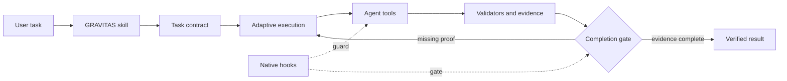

# GRAVITAS

**Makes Gemini work with Claude-grade engineering discipline — read first, plan by risk, prove it with evidence, never fake "done".**

GRAVITAS is an open-source reliability runtime for AI coding agents. It wraps your agent's workflow in a harness that demands reconnaissance before edits, risk-aware plans, externally-executed proof for every claim, and honest failure recovery. It works through portable Agent Skills, and optionally enforces the rules mechanically via Antigravity hooks or an OpenCode plugin shim.

GRAVITAS changes the engineering process, not model weights.

[](https://github.com/udaysharmadev/Gravitas/actions/workflows/gravitas.yml) [](https://skills.sh/udaysharmadev/gravitas) [](LICENSE) [](docs/production-readiness.md)

> Research preview: comparative performance is not yet measured.

## The 30-second pitch

Your agent, without Gravitas:

```text
"fix the login bug" → edits 3 files → "done ✓"
(did it run the tests? did it read the file first? nobody knows)
```

Your agent, with Gravitas:

```text
"fix the login bug" → reads code + tests → writes a contract →
scoped edits → runs a real validator → stale proof rejected →
fresh PASS → "done ✓ (receipts attached)"
```

Same model. Different process. Auditable results.

## Install (pick one)

**Core** — portable skill, works anywhere. Recommended start:

```bash
npx skills add udaysharmadev/Gravitas --skill gravitas --agent antigravity --yes
```

```text
Use Gravitas to fix this bug and verify the result.
```

**Native** — Core + real enforcement inside Antigravity (PreToolUse / PostToolUse / Stop hooks):

```bash
git clone --depth 1 https://github.com/udaysharmadev/Gravitas.git
cd Gravitas
bash scripts/build-native-bundle.sh
agy plugin install "$PWD/dist/gravitas-antigravity"
agy plugin validate "$PWD/dist/gravitas-antigravity"
```

**OpenCode** — one command, permission profile + guard shim:

```bash
gravitas init --host opencode --profile balanced
```

Full guide: [install](docs/install.md) · [quickstart](docs/quickstart.md) · [hosts](docs/hosts.md)

## The 6 invariants (the whole game)

| # | Rule | What it means in practice |
|---|---|---|
| 1 | Ground before mutating | Read target + tests + callers before any edit. No assumed file state. |
| 2 | Stay in declared scope | Writes outside `allowed_write_scope` are denied, not debated. |
| 3 | Completion needs evidence | Only a fresh, Gravitas-owned validator PASS counts. Self-review doesn't. |
| 4 | Never exact-retry a failure | Same fingerprint fails twice → banned until the cause changes (`resolve-failure` re-arms it). |
| 5 | Satisfy the contract | Acceptance criteria + required validators gate completion. "Tests passed" isn't a contract. |
| 6 | Say what you can't verify | Uncertain? Mark it. Fabricated certainty is the real bug. |

## What it actually does for you

- **Stops silent destruction** — `git branch -D`, `rm -rf` smuggled behind `sudo`/`env`/newlines, `find -execdir` tricks: classified destructive, denied or gated. 188 tests say so.
- **Stops fake "done"** — tampered ledgers fail the chain check, stale PASSes (code changed after the green run) are rejected, and the Stop gate loops boundedly then terminates explicitly *unverified* — never a false PASS.
- **Stops config clobbering** — `init` never overwrites an unparseable `opencode.json`, never creates a duplicate next to `opencode.jsonc`, validates profiles before touching anything.
- **Stops silent bypasses** — guard unreachable? Deny. Contract missing or corrupt? Mutating actions denied, reads pass with a warning. No fail-open anywhere.
- **Stays out of the way** — trivial one-file fix → `direct` planning, zero ceremony. Auth migration with 12 files → `deep` + reviewer. Effort follows risk, not ritual.

## How it works



**Core** = behavioral policy via Agent Skills (any host). **Native** = Core + Antigravity plugin that mechanically checks tool calls, records hash-chained evidence, and gates stopping. **OpenCode** = Core + permission profiles + a `tool.execute.before` shim backed by the same policy engine. Capability matrix: [hosts](docs/hosts.md) · concepts: [concepts](docs/concepts.md) · config: [configuration](docs/configuration.md).

## Proof, not promises

- **188 tests, green** — action locking, shell-bypass corpus, scope escapes, session isolation, evidence tampering, stale gates, packaging, CLI, fuzz. Run them: `python -m unittest discover -s tests`
- **Security model, honestly**: [SECURITY.md](SECURITY.md) — hooks are workflow controls, not a sandbox; hash chains are tamper-evident, not tamper-proof.
- **Benchmark honesty**: **30 registered task specifications across 10 planned lanes** in GravitasBench — design and infrastructure, not model results. No model-ranking number belongs here yet. Methodology: [benchmark](docs/benchmark.md) · gates: [production-readiness](docs/production-readiness.md).
- Research grounding (mechanisms, not effect sizes): ReAct, Plan-and-Solve, SWE-bench and friends in [research](docs/research.md). Architecture decisions: [adr](docs/adr/). Latest hardening audit: [v5-audit](docs/audits/v5-audit.md).

## Docs

[Quickstart](docs/quickstart.md) · [Concepts](docs/concepts.md) · [Hosts](docs/hosts.md) · [Configuration](docs/configuration.md) · [Benchmark](docs/benchmark.md) · [Install & troubleshooting](docs/install.md) · [Contributing](docs/contributing.md) · [Security](SECURITY.md) · [Research](docs/research.md) · [ADRs](docs/adr/)

## Contributing

Contributors so far: Uday Sharma, Devansh Singh (#1), Manan Bharti (#2, #3) — see [CONTRIBUTORS.md](CONTRIBUTORS.md). Most useful contributions: licensed benchmark tasks, hidden deterministic validators, live host compatibility checks, privacy review, independent replications. Start with [CONTRIBUTING.md](CONTRIBUTING.md).

## Citation

Use [CITATION.cff](CITATION.cff) and pin a commit until a versioned release and archived benchmark dataset exist.

## Star History

[](https://star-history.com/#udaysharmadev/Gravitas&timeline)

## License

[MIT](LICENSE) © Uday Sharma.
